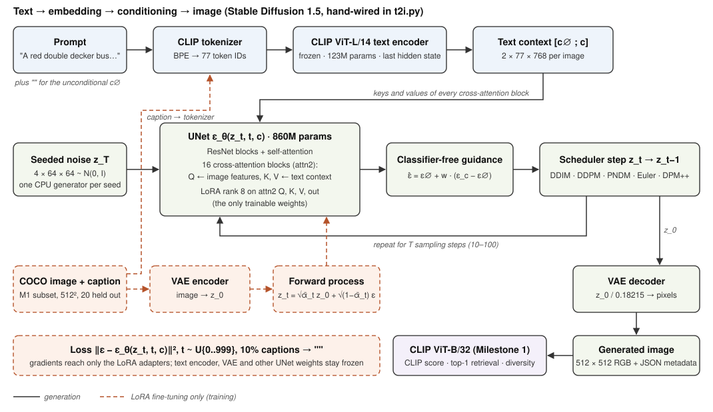

# Milestone 2 — Integration Write-up

**IE7615 Group 3 · Project 2: Text-to-Image Generation** · DRAFT. Values marked **TODO** are filled in from `outputs/logs/` after the full GPU run.

## 1. Approach

We took the **pretrained conditional pipeline** track: Stable Diffusion 1.5 (SD 1.5) with its CLIP ViT-L/14 text encoder. We did not call the packaged `StableDiffusionPipeline`. Instead, we load its five parts separately (tokenizer, text encoder, UNet, VAE, scheduler config) and connect them in our own code (`Milestone 2/t2i.py`), so each hand-off between text, embedding, conditioning and image is explicit and can be inspected. On top of that integration we made one modification to the conditioning path: **LoRA adapters on the UNet's 16 cross-attention blocks**, fine-tuned on our Milestone 1 COCO subset (`Milestone 2/lora.py`).

We chose this track over a from-scratch DDPM because the graded outputs must be "clear and relevant" to COCO captions. A 32×32 or 64×64 DDPM trained on about 3,000 diverse COCO images in our compute budget would produce blurry, weakly aligned samples. A pretrained model lets us spend the milestone on integration, conditioning analysis and sampler experiments. The trade-off is that we cannot re-train with a different β schedule. Section 5 explains how we handle the noise-schedule requirement.

## 2. Architecture

| Stage | Component | Output for one image | Notes |
|---|---|---|---|
| Tokenize | `CLIPTokenizer` (BPE) | 77 token IDs | `<start>` + tokens + `<end>`, padded or truncated to 77. All 20 baseline prompts fit (longest: **TODO** tokens). |
| Encode | `CLIPTextModel`, ViT-L/14 text tower, 123M params, frozen | c ∈ ℝ^{77×768} | We use the **per-token last hidden state**, not the pooled, projected 512-d vector that Milestone 1 used for retrieval. Cross-attention needs one vector per token. |
| Unconditional context | same encoder on `""` | c∅ ∈ ℝ^{77×768} | A learned "no text" context, not zeros. |
| Noise | seeded CPU `torch.Generator`, one per image | z_T ∈ ℝ^{4×64×64} | The same seed gives the same z_T on any GPU and at any batch size. |
| Denoise | `UNet2DConditionModel`, 860M params | ε̂ ∈ ℝ^{4×64×64} | 16 cross-attention (`attn2`) blocks at 64², 32², 16² and 8² resolution. Queries come from image features (320 to 1,280 channels), keys and values from the 768-d text tokens. |
| Guide | our code | ε̂ = ε∅ + w(ε_c − ε∅) | Both branches run in one batch of 2B. With w = 1 only the conditional branch runs. |
| Step | `diffusers` scheduler built from SD's training config | z_{t−1} | Interchangeable: DDPM, DDIM, PNDM, Euler, Euler-a, DPM-Solver++ (with or without Karras σ). |
| Decode | `AutoencoderKL` decoder, 84M params | 512×512 RGB | z₀ / 0.18215 → pixels in [−1, 1] → uint8. |

**How text reaches the image.** The prompt never enters the UNet as pixels or as a single vector. In every cross-attention block, each spatial position of the UNet feature map computes attention weights over the 77 text tokens, softmax(Q·Kᵀ/√d), and adds the weighted sum of the token values to its features. Section 6 of Notebook 1 visualizes these weights: the maps for "cat" and "shelf" light up on the matching regions (**TODO** confirm after the run; figure `04_cross_attention_1.png`).

## 3. Modifications to the pretrained pipeline

1. **Hand-written sampling loop** (`t2i.generate`): encoding, seeded noise, guidance and the scheduler step are our code. It also records per-step diagnostics (latent std, ε RMS, ‖ε_c − ε∅‖) and x̂₀ previews, and accepts replacement text embeddings for the ablations.
2. **Pluggable samplers and schedules** (`t2i.make_scheduler`): any sampler can be built from the model's training noise schedule, with overrides for timestep spacing, Karras σ spacing or the β schedule.
3. **Cross-attention LoRA** (`lora.py`): rank-8 adapters on Q, K, V and the output projection of all 16 `attn2` blocks, about **0.80M trainable parameters (0.09% of the UNet)**. Everything else is frozen, so the fine-tune can change only how the UNet reads the text.
   - The 20 baseline-prompt images are held out from training.
   - Captions are dropped to `""` 10% of the time, so the unconditional branch that CFG depends on keeps training.
   - Training uses fp16 base weights with fp32 adapters, autocast with gradient scaling, and gradient checkpointing.
4. **No safety checker** in the custom loop. The Milestone 1 pipeline's checker blacked out a harmless prompt ("A MAN IS PLAYING ON THE BEACH WITH A FRIEND"). Our prompts are curated COCO captions, and the team reviews every output.

## 4. Verification that the integration works

| Check | Result | Log |
|---|---|---|
| Our loop vs `StableDiffusionPipeline` on the same components, seeds and DDIM scheduler | max pixel difference **TODO**/255 (0/255 in our fp32 CPU test with small random-weight models) | `logs/equivalence_check.json` |
| CLIP-B/32 score, text + CFG vs unconditional vs random context | **TODO** vs **TODO** vs **TODO** (real-photo ceiling **TODO**) | `logs/conditioning_ablation.json` |
| Shuffled embeddings: does the image match the prompt that was *encoded*? | top-1 vs encoded prompt **TODO**, vs intended prompt **TODO** | same |
| One-word edits with a fixed seed (cat→dog, red→blue, zebras→giraffes) | **TODO** | `figures/03_prompt_edits.png` |
| Base vs LoRA on the 20 held-out prompts | CLIP score **TODO** → **TODO** | `logs/lora_vs_base.json` |

The shuffled-embedding test is the strongest evidence. If the generated image follows the swapped embedding and not the intended caption, the text pathway is what determines content.

## 5. Noise schedule: what we can and cannot vary

SD 1.5 was trained with a `scaled_linear` β schedule (0.00085 to 0.012, 1,000 steps), and the UNet's ε prediction is only valid at those noise levels. We therefore vary the **sampling** side: sampler family (DDPM vs DDIM vs higher-order solvers), step count, timestep spacing (`leading`, `trailing`, `linspace`) and Karras σ spacing. We also run one deliberate **train/inference mismatch** test (sampling with linear and cosine β), which degrades the images (**TODO** describe). Training-time schedule comparisons (linear vs cosine) would need re-training. They remain a candidate for a small from-scratch DDPM in Milestone 3 if time allows.

## 6. Reproducing

`Milestone 2/01_integration_and_training.ipynb` (integration checks and fine-tune), then `Milestone 2/02_conditional_generation_sweeps.ipynb` (baseline, sweeps and the gallery PDF). Both run on a Colab T4. Seeds, settings and package versions are written next to every image.
